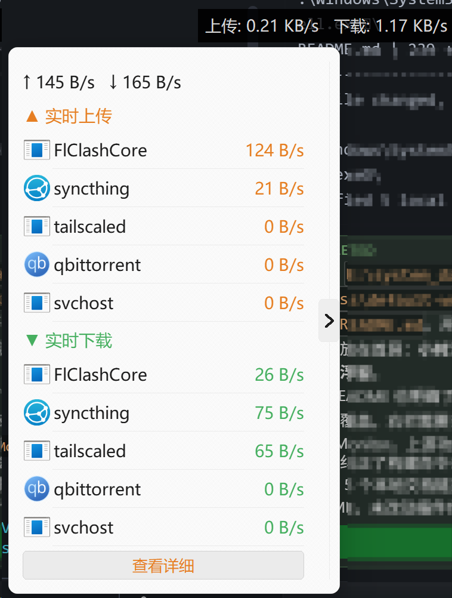
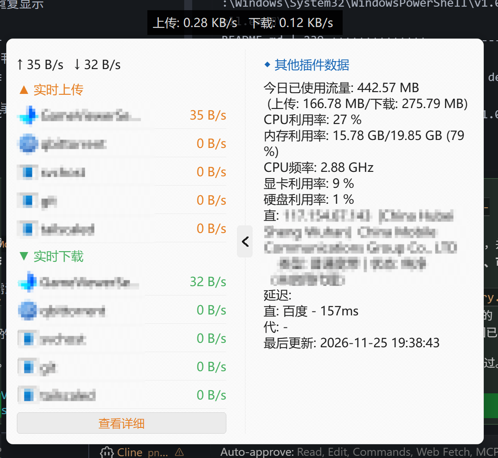

# ProcessNetMonitor：小时流量图表与双栏浮窗

这是 [ProcessNetMonitor](https://github.com/deYangar/ProcessNetMonitor) 的 fork，基于上游 v1.19.0（`1c4f9e6`）。它是 [TrafficMonitor](https://github.com/zhongyang219/TrafficMonitor) 的进程网络监控插件。本分支保留了任务栏网速、进程排行和连接详情，并新增**按小时查看历史流量**和**在同一个浮窗查看宿主及其他插件的提示**。

## Fork 之后的改动

### 历史流量时间范围

点击浮窗里的「查看详细」，切换到「历史流量」。可使用「今日」「昨日」「近3天」「近7天」「近30天」，也可点击「近30天」右侧的「自定义日期」，选择开始日期和结束日期后点击「应用」。

- 可选范围为最近 30 个本地日历日，包含今天。开始日和结束日都计入统计；如果结束日是今天，统计到当前时刻。
- 点击「查看结束日图表」可打开所选范围最后一天的小时图表。切回「历史流量」时，原来的范围仍会保留。


### 小时流量图表

在详情窗口切换到「流量图表」。点击日期按钮可直接从日历中选一天，也可用「前一天」「后一天」逐日切换，或点「今天」回到当天。图表显示所选日期各小时的下载量和上传量。

- **定位某个小时**：点击柱子后，汇总和程序列表只统计该小时。再点同一根柱子，或点击「查看全天」，即可恢复全天统计。
- **查看单个程序**：列表可按程序名、下载量或上传量排序。展开程序行可查看它当天的小时明细。图表的筛选和展开操作与实时进程表分开。
- **保存与恢复**：小时数据以 UTC 记录，图表按系统本地日期展示。定期保存由后台执行。小时历史无法读取时，先尝试备份原文件；备份成功才重新记录，备份失败则暂停写入。

**从上游升级**：旧版 `history.dat` 只有日汇总，不能还原小时分布。本 fork 不导入也不覆盖旧文件，新数据另存为 `history-hourly-v1.dat`，从启用本 fork 后开始积累。


### 双栏悬浮窗

悬停在 TrafficMonitor 主窗口或任务栏窗口时，左栏保留实时网速、上传和下载排行，以及「查看详细」按钮。右栏以蓝色 **「◆ 其他插件数据」** 为固定标题，显示当前悬停目标对应的 TrafficMonitor 统计和其他插件提示，不重复显示 ProcessNetMonitor 自己的提示。该功能可在插件设置内关闭。

- **展开时左右等宽**。右栏正文自动换行，内容超出可见范围时，可使用滚轮或拖动滑块查看全文，不用省略号截断正文。
- **分隔线中间的箭头**可收起或恢复右栏，只查看排行时无需打开设置。
- **宿主要求**：右栏需要支持 `CopyTooltipText()` 的 TrafficMonitor，例如带该接口的[V1.86 构建](https://github.com/WaterCry/TrafficMonitor/tree/processnetmonitor-tooltip)。仅有 V1.86 版本号并不代表接口可用。宿主不支持、没有可用文本或关闭插件选项时，仍可使用原有单栏浮窗。





## 安装与配置

1. 关闭 TrafficMonitor，将与**宿主进程架构**匹配的 DLL 放入其 `plugins/` 目录：x64 使用 `ProcessNetMonitor.dll`，x86 使用 `ProcessNetMonitor_x86.dll`。
2. 重新启动 TrafficMonitor，在插件管理中确认 ProcessNetMonitor 已加载。在任务栏显示项目中按需添加 `Up`、`Down` 或「透明区域」。
3. 悬停查看排行，点击浮窗里的「查看详细」可进入实时流量、历史流量或流量图表。点击任务栏上的 ProcessNetMonitor 插件项可固定浮窗，再点一次解除固定。

插件「选项」中的 **「在浮窗中显示 TrafficMonitor 鼠标提示」** 默认开启，只控制右栏。插件不会修改宿主的原生提示设置。不想同时看到两个提示窗口时，可在 TrafficMonitor 的「主窗口设置」或「任务栏设置」中自行关闭对应的「显示鼠标提示」。

界面默认使用中文，可跟随宿主语言或在插件选项中选择。英文翻译文件位于 `plugin/src/lang/English.ini`，安装位置为 `plugins/ProcessNetMonitor/lang/English.ini`。

## 保留的上游功能

- **任务栏和悬浮窗**：按进程显示上传、下载速度，浮窗分方向显示 Top 5，支持透明区域、深浅主题和高 DPI。
- **详情窗口**：实时表格、按自然日汇总的历史流量、子进程及连接明细、程序签名分类；可选用 ip2region 离线库查看连接归属地。
- **流量采集**：优先使用 ETW 按 PID 统计 TCP 和 UDP，支持过滤 TUN 重复流量。ETW 不可用时回退到 TCP EStats 和 UDP 原始套接字采集。

### 界面参考

以下为仓库中的上游截图，用于参考原有界面，不展示本 fork 的小时图表和双栏功能。

- [任务栏与主窗口](docs/screenshot-main.png)
- [原有悬浮窗](docs/screenshot-popup.png)
- [实时流量详情](docs/screenshot-detail-realtime.png)
- [历史流量详情](docs/screenshot-detail-history.png)

## 数据存储与排障

插件配置目录通常位于 `%APPDATA%\TrafficMonitor\plugins\ProcessNetMonitor\`；宿主使用便携模式时位于 `<TrafficMonitor.exe 所在目录>\plugins\ProcessNetMonitor\`。

| 文件或目录                      | 用途                                   |
| ------------------------------- | -------------------------------------- |
| `history-hourly-v1.dat`       | 本 fork 的小时历史                     |
| `history-hourly-v1.dat.bak.*` | 无法读取的小时历史文件的备份           |
| `history.dat`                 | 上游旧版日汇总，本 fork 不读取、不覆盖 |
| `settings.json`               | 插件及界面设置                         |
| `debug/`                      | 采集诊断和崩溃信息                     |

采集诊断日志默认关闭，可在详情窗口内右键开启。闪退时可提供 `debug/` 下已有的日志或转储，以及 DLL 的版本和架构。右栏未显示时，先检查插件选项是否开启，再确认宿主确实提供 `CopyTooltipText()`。

## 从源码构建

使用 Visual Studio 2022 Build Tools（MSVC `14.44.35207`）、Windows SDK `10.0.26100.0` 和 C++17。`build.bat` 包含原开发机的绝对路径，运行前需将脚本开头的工作目录改为本仓库的 `plugin/`，并核对工具链路径。

```bat
build.bat x64
build.bat x86
build.bat all
```

上述命令只构建，不会关闭、替换或重启 TrafficMonitor。输出位于 `plugin/`。`deploy` 和 `deploy_all` 才会尝试结束宿主进程并部署到脚本指定的测试目录；使用前请核对目标路径。构建 DLL 时保留 `/MT` 静态运行库和显式链接参数 `/OPT:REF`。

上游各版本的详细记录见 [CHANGELOG.md](docs/CHANGELOG.md)。
